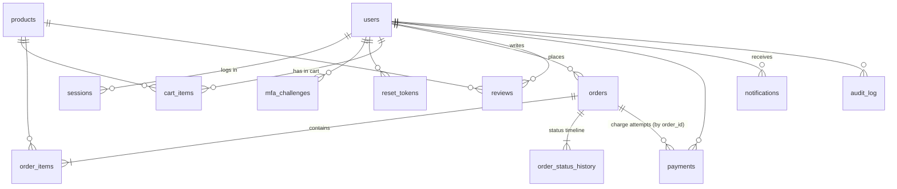

# Database (MySQL)

All app data lives in one MySQL 8 database. In AWS it's the RDS for MySQL instance from `infra/terraform/database.tf`, and locally it's a Docker container. The API servers keep no state of their own, so any number of them can run behind the ALB. A login on one server works on the next request to another.

- **Schema:** [`src/db/migrations/`](src/db/migrations/), starting with `001_initial_schema.sql`.
- **Access code:** [`src/lib/db.js`](src/lib/db.js), using `mysql2` with plain SQL.
- **Demo data:** [`src/seed.js`](src/seed.js).

## How it gets created

You never run SQL by hand. When an API server starts, it runs `src/lib/db.js` `migrate()` and then `seed()`:

1. **Migrate.** Every `src/db/migrations/*.sql` file that isn't yet listed in the `schema_migrations` table is applied, in filename order. A MySQL lock (`GET_LOCK`) makes servers that start together take turns.
2. **Seed.** If `products` is empty, the demo data is inserted in one transaction, also under a lock, so it happens only once.

The server only starts listening after both steps finish. If the database can't be reached, the process exits and systemd restarts it 10 seconds later.

**Changing the schema:** add a new file such as `002_add_order_worker_columns.sql`. Never edit a migration that has already been applied, because servers that already ran it won't run it again. MySQL can't roll back DDL, so keep each migration small.

## Connection settings

| Env var | AWS (set by `user_data.sh.tftpl`) | Local default |
|---|---|---|
| `DB_HOST` | RDS endpoint | `127.0.0.1` |
| `DB_PORT` | – | `3306` |
| `DB_NAME` | `kaya` | `kaya` |
| `DB_SECRET_ARN` | RDS-managed master secret | – |
| `DB_USER` / `DB_PASSWORD` | – (taken from the secret) | `kaya` / `kaya` |

In AWS the server reads the username and password from Secrets Manager and connects over TLS, using the RDS CA bundle that ships with `mysql2`. RDS rotates that password every 7 days. When new connections start failing, the pool fetches the secret again and retries.

## Running locally

```bash
cd backend
docker compose up -d          # MySQL 8.4 on localhost:3306 (databases kaya and kaya_test)
npm start                     # migrates + seeds kaya on first run
npm run seed                  # wipe kaya and reseed
node --test                   # tests run against kaya_test (wiped first)
```

To look at the data: `docker compose exec mysql mysql -ukaya -pkaya kaya`.

## Looking at the RDS database in AWS

The database is in a private subnet. Tunnel to it through an API instance with Session Manager, which needs the Session Manager plugin installed:

```bash
cd infra/terraform
aws ssm start-session --target <api-instance-id> \
  --document-name AWS-StartPortForwardingSessionToRemoteHost \
  --parameters host=$(terraform output -raw db_endpoint),portNumber=3306,localPortNumber=3307
# in another terminal: the password is in the secret
aws secretsmanager get-secret-value --secret-id $(terraform output -raw db_secret_arn) --query SecretString --output text
mysql -h 127.0.0.1 -P 3307 -u kaya_admin -p kaya      # or MySQL Workbench / DBeaver on 127.0.0.1:3307
```

## Conventions

- **Timestamps** are `DATETIME(3)` in **UTC**. The API turns them into epoch milliseconds. Singapore time is UTC+8 with no daylight saving, so `created_at + INTERVAL 8 HOUR` gives SGT.
- **Money** is `DECIMAL`, and the column name tells you the currency:
  - `products.price`, every `*_sgd` column and `promotions.min_spend` are **SGD**.
  - `orders.subtotal`, `discount`, `shipping` and `total`, and `order_items.unit_price`, are in the order's own `currency` (SGD/MYR/THB/HKD).
- **IDs** are prefixed strings (`usr_…`, `prd_<slug>`, `pmt_…`). Order IDs are `KK100123`. The number comes from the `order_numbers` auto-increment table, so two servers can never create the same order ID.
- **Statuses** are `VARCHAR`, not `ENUM`, so adding a new state needs no schema change.
- **Orders keep snapshots** of what was bought: item name, price, delivery address and email. Editing a product later doesn't rewrite order history.

## Tables



| Table | What's in it |
|---|---|
| `users` | Customers, staff and admins. `role` is `customer`, `staff` or `admin`. `password_hash` is NULL for SSO-only accounts. The address is stored in the `address_*` columns. |
| `sessions` | Login sessions. Holds the SHA-256 hash of the bearer token, with a 7-day expiry. |
| `mfa_challenges`, `reset_tokens` | Short-lived MFA codes (5 minutes) and password-reset tokens (30 minutes). |
| `products` | The catalogue. `stock` is `UNSIGNED`, so it can never go below 0. `sale_pct` is the strikethrough sale. |
| `promotions` | Promo codes (`WELCOME10`, `KAYA1111`, `FREESHIP`). |
| `reviews` | One per user per product. `verified` means the reviewer had a paid order containing that product. |
| `cart_items` | Server-side carts for logged-in users. |
| `orders` | One row per order: totals, payment state and fulfilment. `address`, `pickup_slot` and `paynow` are JSON. |
| `order_items` | The order's lines, with name and price snapshots. |
| `order_status_history` | The timeline shown on the order page. Every status change adds a row. |
| `payments` | Every charge attempt, including declined ones. Only the card brand and last 4 digits are stored. |
| `notifications` | The email/SMS outbox, shown in Account and Back office → Notifications. |
| `reports` | Metadata for report files written to the S3 reports bucket. |
| `audit_log` | Staff and security actions: logins, product edits, order status changes. |
| `order_numbers`, `schema_migrations` | Internal tables: the order number sequence and the migration bookkeeping. |

### Order states

`orders.status` moves `pending_payment` (PayNow not yet received) → `processing` → `shipped` / `ready_for_pickup` → `delivered`. An order can become `cancelled` from `pending_payment` or `processing`. `order_status_history` also records `placed` as the first event.

`orders.payment_status` is one of `pending`, `paid`, `refunded` or `cancelled`.

## Seed data

These rows are inserted only when the database is empty:

- **12 products**, with a 15% sale on Musang King Durian and 10% on the Heritage Gift Box.
- **3 promo codes:** `WELCOME10`, `KAYA1111` and `FREESHIP`.
- **3 accounts.** MFA is **off** for all of them, so the back office works in AWS too:

  | Role | Email | Password |
  |---|---|---|
  | Admin | `admin@koolkaya.sg` | `Admin@1234` |
  | Staff | `staff@koolkaya.sg` | `Staff@1234` |
  | Customer | `demo@koolkaya.sg` | `Demo@1234` |

- **9 synthetic shoppers** across SG, MY, TH and HK.
- **36 reviews.**
- **160 paid orders from the last 30 days**, about 80% from Singapore, each with a payment row.

## Notes for the rest of the team

**Order worker (SQS → Lambda).**
- **Network access:** to reach the database, the Lambda needs:
  - a `vpc_config` in the app subnet
  - an ingress rule on `aws_security_group.db` for port 3306 from its own security group
  - `secretsmanager:GetSecretValue` on the DB secret, plus `kms:Decrypt` on the project key
- **Connection settings:** pass the same `DB_HOST`, `DB_NAME` and `DB_SECRET_ARN` env vars the API gets.
- **Writing safely:** two patterns keep concurrent writers correct:

  ```sql
  -- Take stock only if there's enough (affectedRows = 0 means sold out):
  UPDATE products SET stock = stock - ? WHERE id = ? AND stock >= ?;
  -- Change status only from the state you expect, and record it on the timeline:
  UPDATE orders SET status = 'rejected', updated_at = UTC_TIMESTAMP(3) WHERE id = ? AND status = ?;
  INSERT INTO order_status_history (order_id, status, note, at) VALUES (?, 'rejected', 'order-worker', UTC_TIMESTAMP(3));
  ```

  Wrap the stock update and the status change in one transaction.
- **New states:** `confirmed` and `rejected` can be used without a migration.

**Reporting.**
- **Today:** the report Lambda keeps working as it is. The API instance it calls now reads the shared database, so the reports are correct with several instances running.
- **To query MySQL directly from the Lambda:** the sales CSV is `orders` joined to `order_items` where `payment_status = 'paid'`. See `paidOrders()` in `src/services/reports.js`.

**Data archival.**
- **Which orders count as closed:** those with `status IN ('delivered', 'cancelled')`, filtered on `created_at`. There's an index on `(status, created_at)` for this.
- **Deleting:** deleting an order row also deletes its `order_items` and `order_status_history`. `payments` has no foreign key, so delete those rows by `order_id`.
- **Demo data range:** the seed data only covers the last 30 days, so shorten the 2-year cutoff for the demo, for example to `INTERVAL 7 DAY`.

**Monitoring.**
- The RDS instance and its identifier haven't changed, so the existing CPU and storage alarms still apply.
